# Secure Login System

A production-shaped, secure authentication system built with Node.js, Express, SQLite, and TOTP two-factor authentication. Designed as a reference implementation for secure login flows: bcrypt password hashing, server-side sessions, CSRF protection, rate limiting, account lockout, strict security headers, and SQL injection protection via parameterized queries.

## Features

- **Registration** — full name, email, username, password, confirm password; unique email/username enforcement; strong password rules (12–72 chars, mixed classes, no personal details, not a common password); bcrypt hashing; no plaintext passwords anywhere.
- **Login** — username or email; `bcrypt.compare` verification; generic auth errors; rate limiting and brute-force prevention; account-level lockout after 5 failures for 15 minutes; session ID regenerated on success.
- **Dashboard** — welcome message, account info, login status, creation date, last sign-in, recent security activity, logout; authenticated access only.
- **Sessions** — server-side SQLite-backed store; HttpOnly, SameSite=Lax cookies; Secure in production; rolling expiration; full destroy on logout; no auth tokens in localStorage.
- **Optional TOTP 2FA** — QR code setup, manual secret entry, verification challenge, recovery codes (10 single-use codes), encrypted secret storage (AES-256-GCM), enable/disable with password + code, recovery-code regeneration.
- **SQL injection protection** — parameterized queries only; database constraints and indexes.
- **Security headers** — Helmet with strict CSP (`'self'` scripts/styles, `style-src-attr 'none'`, `img-src 'self' data:`), `X-Frame-Options: DENY`, `X-Content-Type-Options: nosniff`, `Referrer-Policy: no-referrer`, COOP/CORP, Permissions-Policy; `X-Powered-By` removed.
- **CSRF** — `csrf-sync` synchronizer-token pattern; `GET /api/csrf-token`; `X-CSRF-Token` header on state-changing requests; automatic retry with fresh token on `CSRF_INVALID`.
- **Rate limiting** — per-route limiters for login/register/2FA plus a broad API limiter.
- **Validation** — `express-validator` on all request bodies; snake_case API fields (`full_name`, `confirm_password`).
- **Frontend** — dark navy/electric-blue glassmorphism UI, responsive, password toggles, strength indicators, loading states, accessible markup; no inline scripts/styles (strict CSP); system font stack.

## Stack

| Layer | Technology |
|-------|------------|
| Runtime | Node.js (≥20) |
| Web framework | Express 4 |
| Database | SQLite (`better-sqlite3`) |
| Password hashing | bcrypt |
| Sessions | `express-session` + custom SQLite store |
| CSRF | `csrf-sync` |
| Rate limiting | `express-rate-limit` |
| Validation | `express-validator` |
| Security headers | Helmet |
| TOTP | `otplib` |
| QR codes | `qrcode` |
| Tests | Node `--test` + `supertest` |

## Screenshots

Landing page:

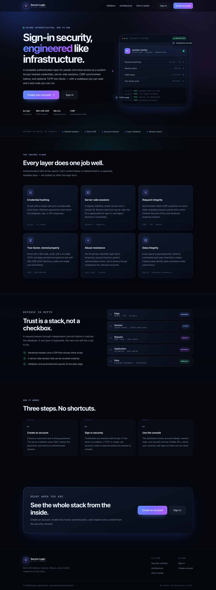

Registration with live password-strength meter:

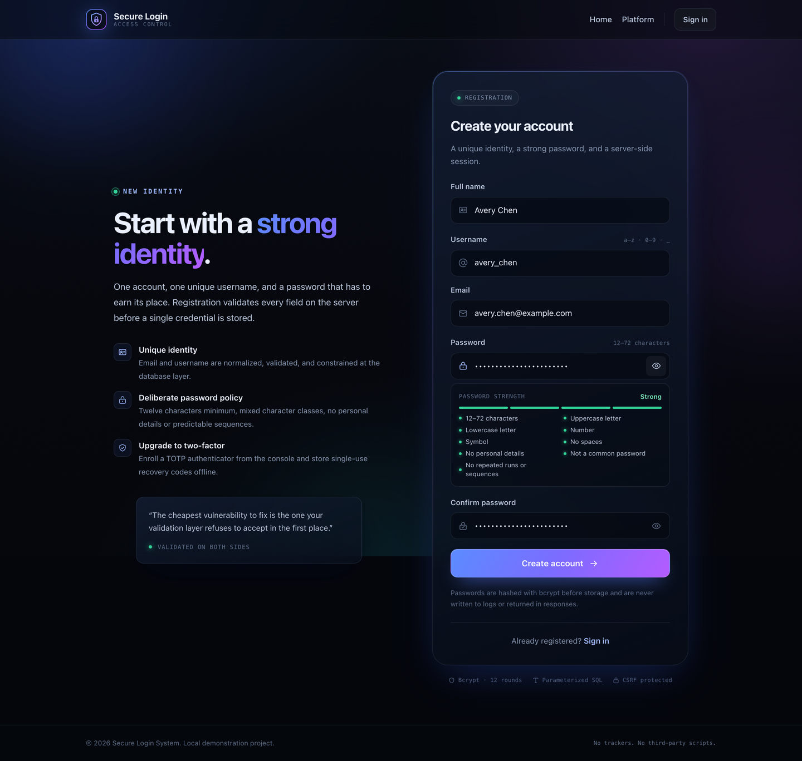

Login page (post-logout banner shown):

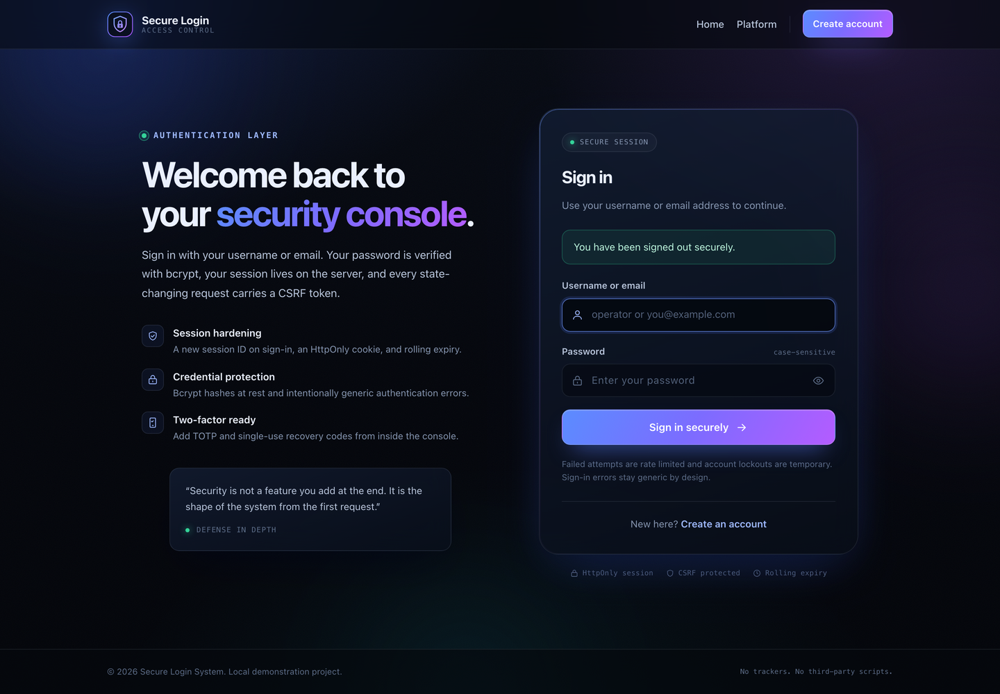

Dashboard — authenticated session:

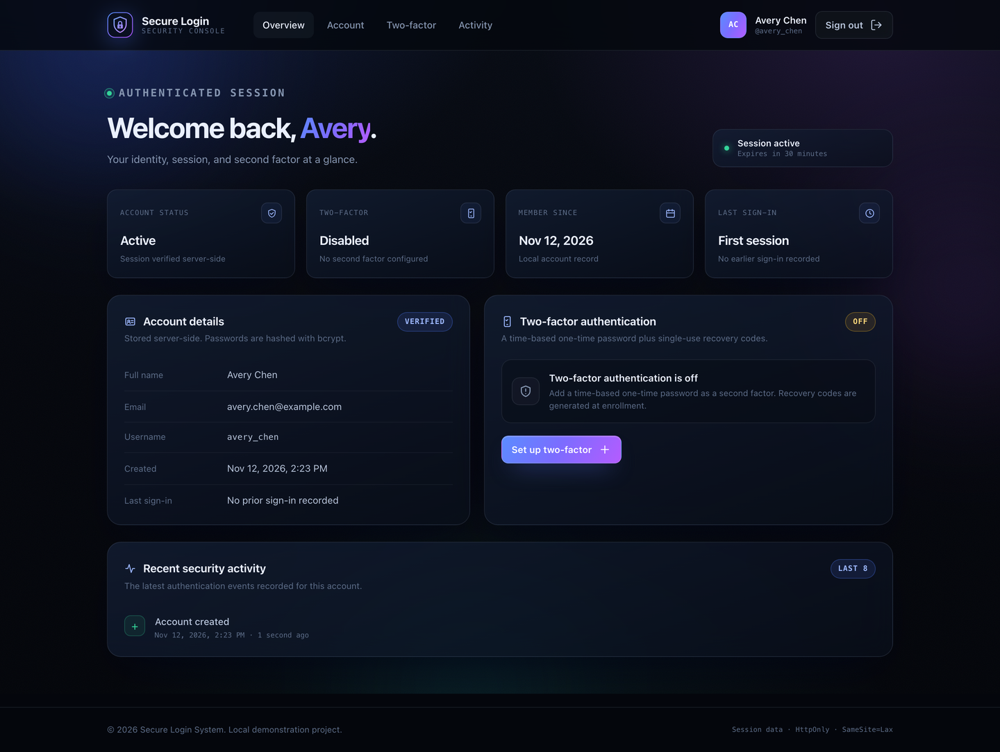

Dashboard with 2FA enabled:

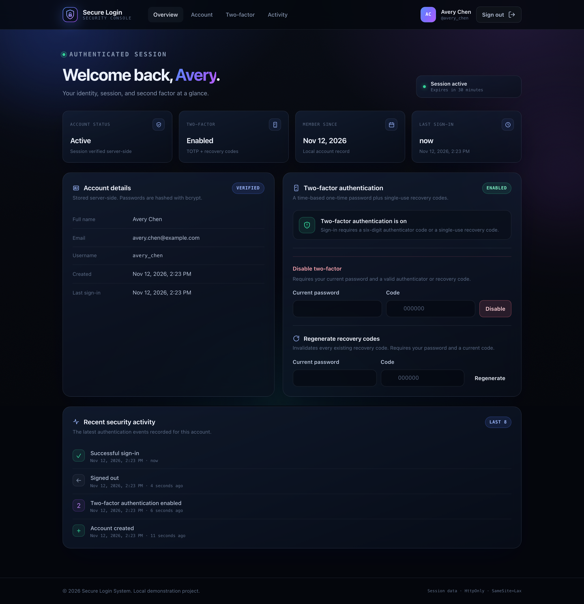

TOTP setup — QR code, manual setup key, enable form:

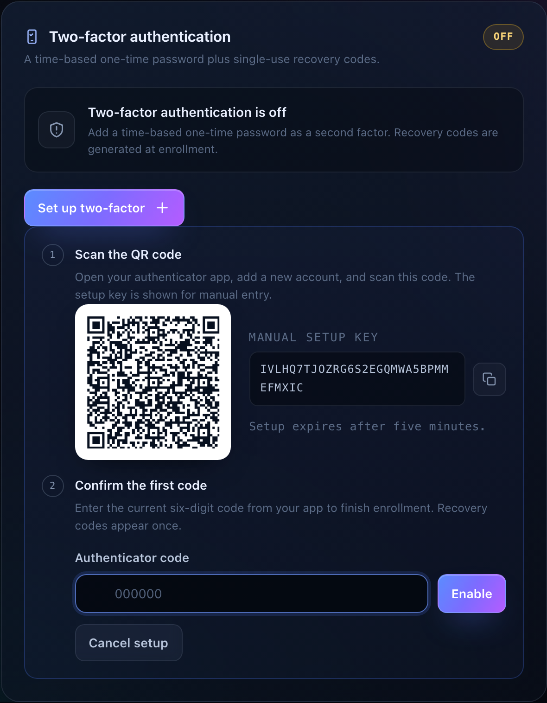

Recovery codes — ten single-use codes shown once:

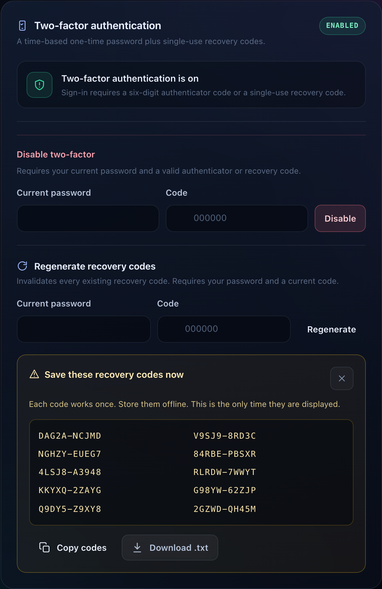

TOTP challenge after password login:

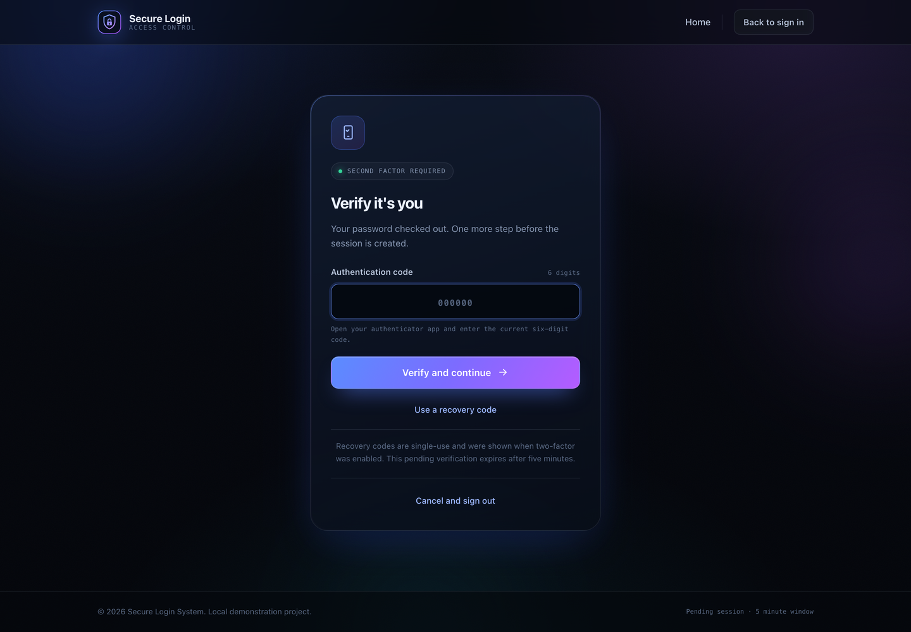

404 page:

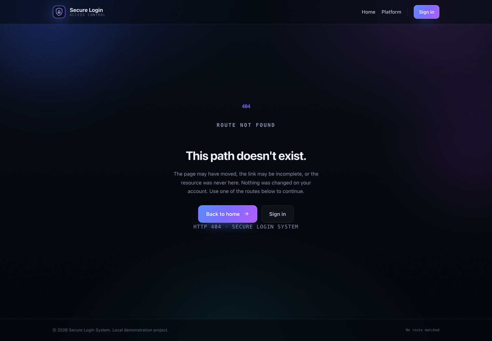

Mobile navigation open:

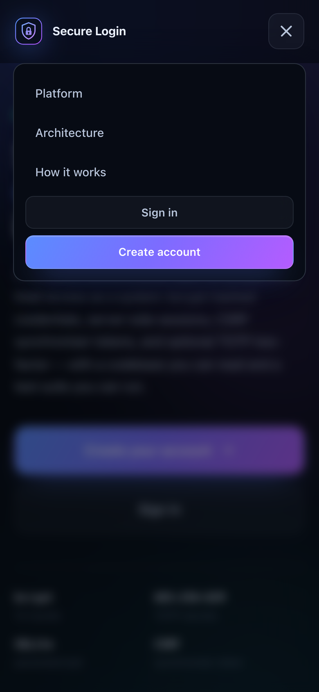

Mobile login:

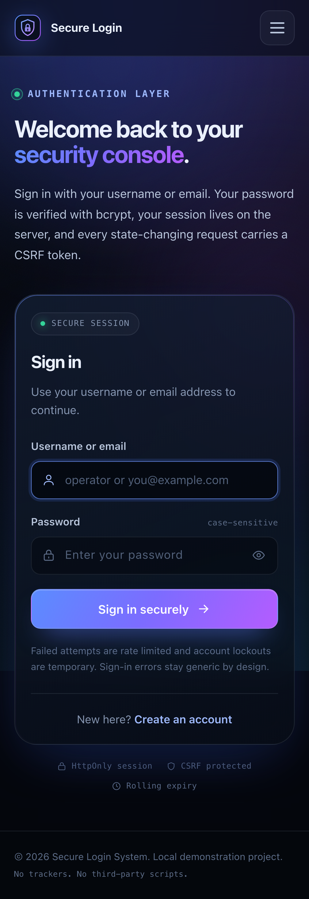

> All screenshots were captured from a disposable demo account (`avery_chen`) that was deleted after capture, so the QR secret and recovery codes shown are invalid.

## macOS setup

### 1. Install dependencies

```bash
cd /Users/naveenprasanth/secure-login-system
npm install
```

Native modules (`bcrypt`, `better-sqlite3`) build from precompiled binaries on macOS ARM64/x86_64. If a rebuild is needed:

```bash
npm rebuild bcrypt better-sqlite3
```

### 2. Configure environment

```bash
cp .env.example .env
chmod 600 .env
```

Edit `.env` and replace every `replace-with-*` placeholder with cryptographically random hex. Generate them on macOS:

```bash
openssl rand -hex 64   # SESSION_SECRET
openssl rand -hex 32   # TWO_FACTOR_ENCRYPTION_KEY
openssl rand -hex 32   # RECOVERY_CODE_PEPPER
```

Key settings:

| Variable | Purpose | Default |
|----------|---------|---------|
| `NODE_ENV` | `development` or `production` (controls Secure cookie flag) | `development` |
| `PORT` | HTTP port | `3000` |
| `SESSION_SECRET` | Express session signing secret | *(required)* |
| `TWO_FACTOR_ENCRYPTION_KEY` | AES-256-GCM key encrypting TOTP secrets at rest | *(required)* |
| `RECOVERY_CODE_PEPPER` | HMAC pepper hashing recovery codes | *(required)* |
| `DATABASE_PATH` | SQLite file path | `database/secure-login.sqlite` |
| `SESSION_TTL_MINUTES` | Session rolling lifetime | `30` |
| `BCRYPT_ROUNDS` | bcrypt cost factor | `12` |
| `LOGIN_RATE_LIMIT_MAX` | Login attempts per window | `5` |
| `ACCOUNT_LOCK_THRESHOLD` | Failed logins before lockout | `5` |
| `ACCOUNT_LOCK_MINUTES` | Lockout duration | `15` |
| `TRUST_PROXY` | Trust `X-Forwarded-*` from a reverse proxy | `false` |
| `TWO_FACTOR_ISSUER` | TOTP issuer label | `Secure Login System` |

> Set `TRUST_PROXY=true` only when the app sits behind a trusted reverse proxy that sets `X-Forwarded-*` headers; the IP rate limiter relies on the connection's remote address otherwise.

### 3. Initialize the database

The schema is applied automatically on first start via `database/schema.sql` (tables: `users`, `sessions`, `security_events`, `recovery_codes`). No separate migration step is required.

```bash
ls database/
# secure-login.sqlite  (created on first run)
```

To start from a clean database, remove the file and restart:

```bash
rm -f database/secure-login.sqlite
```

### 4. Start the server

```bash
npm start
```

Output:

```
Secure Login System listening on http://localhost:3000 (development)
```

Open `http://localhost:3000` in a browser. In development, cookies are not marked `Secure` (HTTP is fine); in production (`NODE_ENV=production`) the app expects HTTPS so cookies become Secure-only.

For automatic restart during development:

```bash
npm run dev   # requires nodemon (devDependency)
```

### 5. Run the test suite

Tests use Node's built-in test runner with `supertest`, an in-memory SQLite database, low bcrypt cost (rounds 4), and fixed test secrets. They run serially:

```bash
npm test
```

Expected output:

```
ok 33 - ...
...
# tests 33
# pass 33
# fail 0
# ...
```

Test coverage:

- Successful registration
- Duplicate email rejection
- Duplicate username rejection
- Successful login
- Incorrect password rejection
- Invalid email rejection
- Weak password rejection
- SQL injection payload handling
- Unauthorized dashboard access (401 redirect)
- Authenticated dashboard access
- Logout / session destruction
- Session expiration
- Login rate limiting / brute-force prevention
- TOTP setup, enable, disable, recovery codes

## Security features

| Control | Implementation |
|---------|---------------|
| Password storage | bcrypt (configurable rounds, default 12); plaintext passwords never logged or returned |
| Session storage | Server-side SQLite store; cookie holds only `sls.sid` |
| Session cookie | HttpOnly, SameSite=Lax, Secure in production, rolling expiration |
| Session fixation | New session ID issued on successful login; full destroy on logout |
| CSRF | `csrf-sync` synchronizer tokens; `X-CSRF-Token` header; fresh token on `CSRF_INVALID` |
| Brute force | Per-identifier rate limiting + account lockout (5 failures / 15 min) |
| Auth enumeration | Generic error messages; dummy bcrypt comparison on missing users |
| SQL injection | Parameterized queries only; `better-sqlite3` prepared statements |
| Headers | Helmet strict CSP, `X-Frame-Options: DENY`, `nosniff`, `no-referrer`, COOP/CORP, Permissions-Policy |
| 2FA secrets | AES-256-GCM encrypted (`v1:` prefix) at rest |
| Recovery codes | HMAC-SHA256 hashed with pepper; single-use; displayed once at generation |
| CSP | Scripts/styles `'self'` only; `style-src-attr 'none'`; `img-src 'self' data:`; no inline scripts/styles/event handlers |
| Static assets | Served only from `/css`, `/js`, `/images`; `.html` files are not directly reachable |

## Project structure

```
secure-login-system/
├── README.md
├── package.json
├── .env.example
├── .gitignore
├── server.js                  # App entry point; graceful shutdown
├── app.js                     # createApp() factory + middleware wiring
├── database/
│   ├── schema.sql             # Users, sessions, security_events, recovery_codes
│   └── secure-login.sqlite    # Created on first run (gitignored)
├── config/
│   ├── env.js                 # Environment parsing (preserves ':memory:')
│   ├── database.js            # createDatabase()
│   ├── session.js             # express-session + cookie settings
│   └── SQLiteSessionStore.js  # Custom SQLite-backed session store
├── middleware/
│   ├── auth.js                # Authentication middleware
│   └── validation.js          # express-validator rule factories
├── routes/
│   ├── auth.js                # /api/auth/* + /api/2fa/* + /api/csrf-token
│   ├── dashboard.js           # /api/dashboard
│   └── pages.js               # Page HTML controllers (/ /login /register /two-factor /dashboard /404)
├── public/
│   ├── index.html             # Landing
│   ├── login.html
│   ├── register.html
│   ├── dashboard.html
│   ├── two-factor.html        # (served via page router)
│   ├── 404.html
│   ├── css/styles.css         # Design system + all page styles
│   ├── js/common.js           # Shared API client, CSRF retry, toasts, nav, reveals
│   ├── js/register.js
│   ├── js/login.js
│   ├── js/two-factor.js
│   ├── js/dashboard.js
│   └── images/                # Logo mark, favicon
├── tests/
│   ├── auth.test.js
│   ├── dashboard.test.js
│   ├── security.test.js
│   ├── rate-limit.test.js
│   ├── two-factor.test.js
│   └── support/test-app.js    # Shared app factory + 2FA helpers
├── utils/                     # Password strength, TOTP, encryption, recovery codes
└── screenshots/               # 11 optimized PNG screenshots
```

## Future improvements

- Email-based account verification and password reset (rate-limited, time-bound tokens)
- Remember-me with long-lived rotating refresh tokens
- Password breach checking (Have I Been Pwned k-Anonymity API)
- Device/session management page (revoke individual sessions)
- WebAuthn / passkeys as a second factor alternative
- Audit log export and security-event email alerts
- Password strength zxcvbn integration
- Production deployment notes: reverse proxy (TLS termination), `TRUST_PROXY=true`, `Secure` cookies, regular dependency updates via `npm audit`

## License

MIT